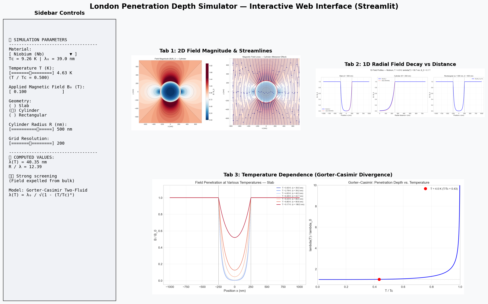
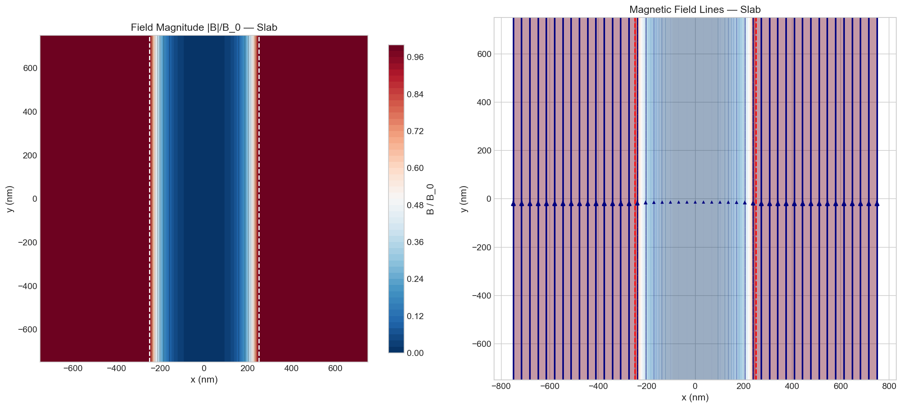
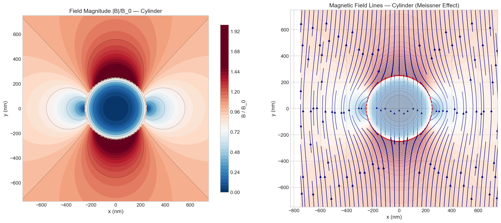
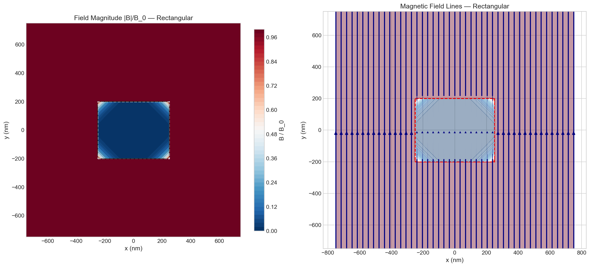
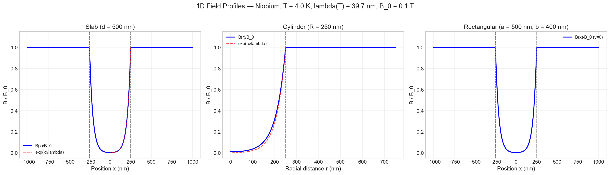
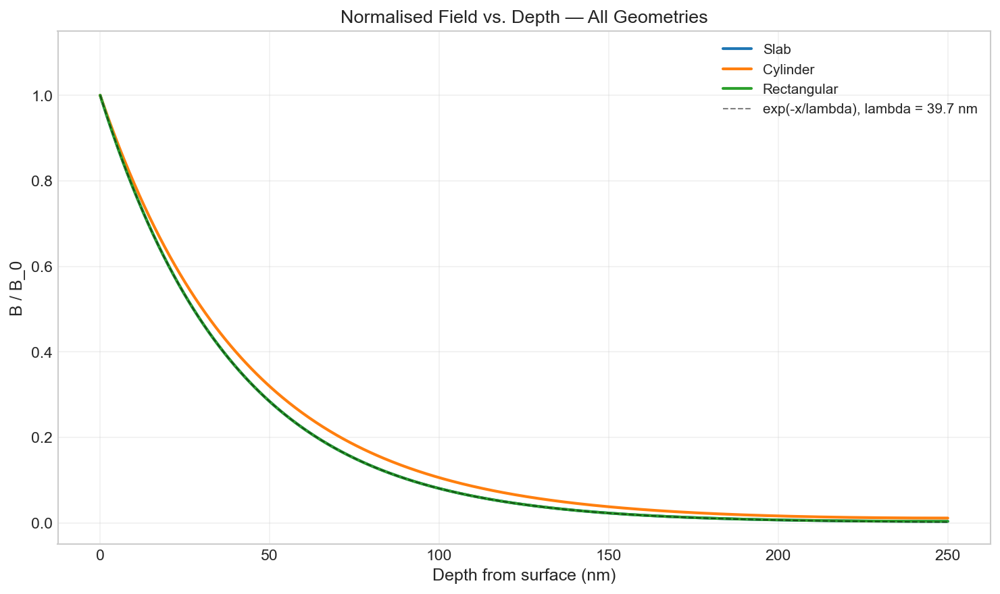
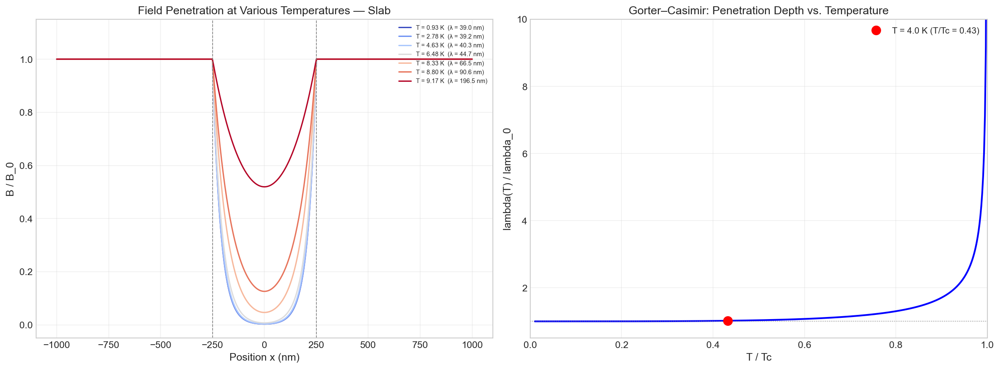
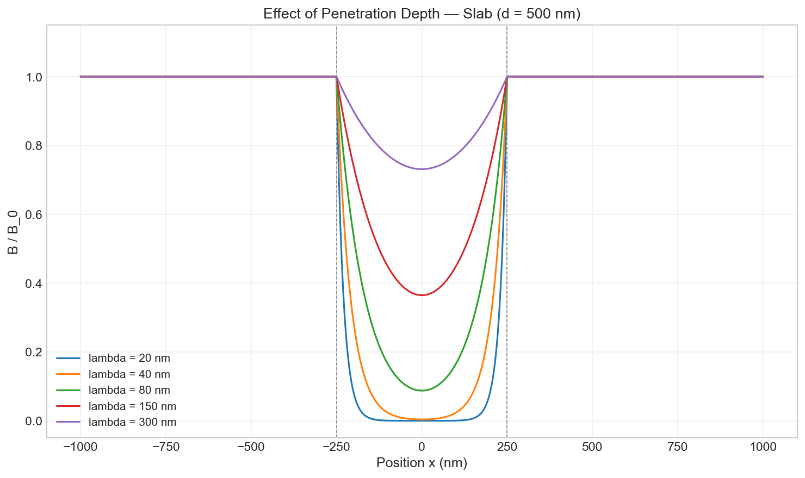
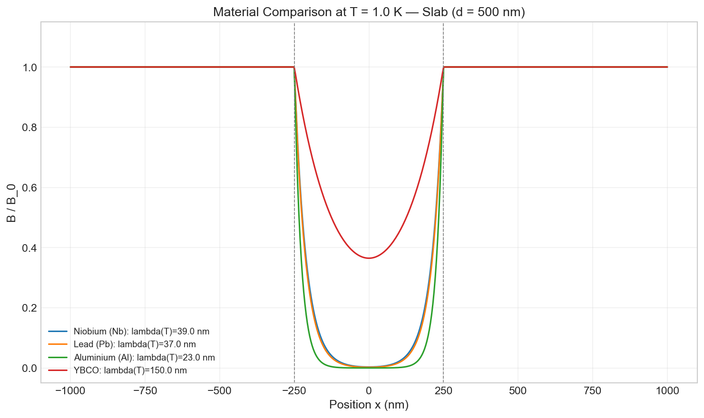

# Interactive Simulation of Magnetic-Field Penetration in Diamagnetic Materials (London Model)

[](https://www.python.org/downloads/)
[](https://streamlit.io/)
[](test_suite.py)
[](https://opensource.org/licenses/MIT)

**Indian Institute of Technology Hyderabad (IIT Hyderabad)**  
**Department of Physics | B.Tech. Engineering Physics**  
**Course**: Solid State Physics — Assignment 1 (Question 6)  
**Course Instructor**: Prof. Arabinda Haldar  

---

### 👥 Team Members
1. **EP24BTECH11025** — Sameer Choudhary*
2. **EP24BTECH11024** — Samarth Gupta
3. **EP24BTECH11032** — Tejas Prashant Bharadwaj
4. **EP24BTECH11026** — Samyak Rai
5. **EP24BTECH11027** — Saraangan B
6. **EP24BTECH11028** — Savireddy Ansika
7. **EP24BTECH11029** — Shanmukh Machiraju
8. **EP24BTECH11030** — Snigdha Indupalli
9. **EP24BTECH11031** — Srija Baratam
10. **EP24BTECH11033** — Vishal

---

## 📌 Executive Overview

This repository delivers an end-to-end computational physics platform and interactive visualization application exploring the **Meissner–Ochsenfeld effect** and magnetic flux screening in superconductors governed by the **London equations**.

By solving the governing Helmholtz equation ($\nabla^2 \mathbf{B} = \mathbf{B}/\lambda^2$) across planar slab, cylindrical, and rectangular geometries, the application models how screening supercurrents attenuate external magnetic fields over the microscopic **London penetration depth** ($\lambda_L$).


*Figure 1: Full interactive dashboard interface rendered via Streamlit, displaying live sidebar controls, 2D field maps, 1D attenuation profiles, and Gorter–Casimir temperature curves.*

---

## 🧮 Theoretical Framework

### 1. The London Equations (1935)
To explain why superconductors actively expel magnetic flux rather than simply trapping it, Fritz and Heinz London formulated two phenomenological equations for the superfluid carrier density $n_s$:

1. **First London Equation** (ballistic acceleration of Cooper pairs):
   $$\frac{\partial \mathbf{J}_s}{\partial t} = \frac{n_s e^2}{m} \mathbf{E}$$
2. **Second London Equation** (flux expulsion / screening condition):
   $$\nabla \times \mathbf{J}_s = -\frac{n_s e^2}{m} \mathbf{B}$$

Taking the curl of Maxwell-Ampère's law ($\nabla \times \mathbf{B} = \mu_0 \mathbf{J}_s$) and utilizing Gauss's law for magnetism ($\nabla \cdot \mathbf{B} = 0$):
$$\nabla^2 \mathbf{B} = \frac{1}{\lambda_L^2} \mathbf{B}$$

where $\lambda_L$ is the **London penetration depth**:
$$\lambda_L = \sqrt{\frac{m}{\mu_0 n_s e^2}}$$

### 2. Temperature Dependence (Gorter–Casimir Two-Fluid Model)
The temperature-dependent superfluid density is parameterized by:
$$n_s(T) = n_0 \left[1 - \left(\frac{T}{T_c}\right)^4\right] \quad (T < T_c)$$

Substituting into the definition of $\lambda_L$ yields:
$$\lambda(T) = \frac{\lambda_0}{\sqrt{1 - \left(\frac{T}{T_c}\right)^4}} \quad (T < T_c)$$

At $T \ge T_c$, $\lambda \to \infty$ and $n_s \to 0$, marking the second-order phase transition to the normal metallic state.

### 3. Geometry-Specific Analytical Solutions

| Geometry | Coordinate System | Governing Analytical Equation |
|---|---|---|
| **Infinite Slab** (thickness $d$, $|x| \le d/2$) | Cartesian | $$B(x) = B_0 \frac{\cosh(x/\lambda)}{\cosh(d / 2\lambda)}$$ |
| **Long Cylinder** (radius $R$, $r \le R$) | Cylindrical | $$B(r) = B_0 \frac{I_0(r/\lambda)}{I_0(R/\lambda)}$$ *(with $I_0$ modified Bessel)* |
| **Rectangular Cross-Section** ($a \times b$) | 2D Cartesian | $$B(x, y) \approx B_0 \left[ \frac{\cosh(x/\lambda)}{\cosh(a / 2\lambda)} \right] \cdot \left[ \frac{\cosh(y/\lambda)}{\cosh(b / 2\lambda)} \right]$$ |

---

## 📸 Simulation Results & Visualizations

### 2D Magnetic Field Maps & Streamlines
The 2D visualizers compute scalar field magnitude $|B|/B_0$ colourmaps and vector field streamplots $(\mathbf{B}_x, \mathbf{B}_y)$, illustrating the active deflection of magnetic flux lines around the diamagnetic boundaries:

| Slab Geometry ($d = 500\text{ nm}$) | Circular Cylinder ($R = 250\text{ nm}$) | Rectangular Prism ($500 \times 400\text{ nm}$) |
|:---:|:---:|:---:|
|  |  |  |

### 1D Decay Profiles & Geometric Comparison
Field screening varies across geometries due to screening current topology:
- **Cylinders** exhibit the steepest decay because azimuthal current loops concentrate shielding along the axis.
- **Slabs** exhibit 1D planar shielding currents.
- **Rectangles** exhibit intermediate decay with two-dimensional edge screening.

| 1D Spatial Field Profiles | Geometry Attenuation Overlay |
|:---:|:---:|
|  |  |

### Thermal Criticality & Material Studies

| Temperature Dependence & Divergence | Penetration Depth Variation | Multi-Material Comparison at 1 K |
|:---:|:---:|:---:|
|  |  |  |

---

## 🚀 Installation & Quick Start

### 1. Prerequisites
Ensure Python 3.9 or higher is installed:
```bash
python3 --version
```

### 2. Setup Virtual Environment (Recommended)
```bash
python3 -m venv venv
source venv/bin/activate  # On Windows: venv\Scripts\activate
```

### 3. Install Dependencies
```bash
pip install -r requirements.txt
```

### 4. Launch the Interactive Web Application
```bash
streamlit run app.py
```
Open your web browser at `http://localhost:8501`.

### 5. Execute the Automated Test Suite
```bash
python3 test_suite.py
```

### 6. Rebuild All Publication Figures
```bash
python3 generate_figures.py
```

### 7. Compile the Final PDF Report
```bash
python3 generate_report_pdf.py
```

---

## 📂 Repository File Structure

```plaintext
SSP Assignment/
├── Assignment-1.pdf              # Original assignment brief (Question 6)
├── SSP_Assignment1_Q6_Report.pdf # Final submission-ready academic report (18 pages)
├── README.md                     # GitHub presentation documentation
├── REPORT.md                     # Academic Markdown report with derivations & citations
├── PROJECT_GUIDE.md              # Comprehensive project guide and manual
├── requirements.txt              # Production dependency specifications
├── .gitignore                    # Python, Streamlit, and OS exclusions
├── london_physics.py             # Numerical physics engine (zero UI dependencies)
├── app.py                        # Interactive Streamlit GUI application
├── generate_report_pdf.py        # Automated PDF report builder (fpdf2)
├── generate_figures.py           # Automated batch plotting script
├── test_suite.py                 # Automated unit and physical consistency test suite
├── equations_rendered/           # Rendered LaTeX equation image assets
└── figures/                      # Directory of generated figures and UI captures
    ├── app_interface_overview.png
    ├── fig1_2d_slab.png
    ├── fig2_2d_cylinder.png
    ├── fig3_2d_rectangle.png
    ├── fig4_1d_profiles.png
    ├── fig5_temperature_dependence.png
    ├── fig6_geometry_comparison_2d.png
    ├── fig7_geometry_comparison_1d.png
    ├── fig8_lambda_study.png
    ├── fig9_B0_study.png
    ├── fig10_temp_cylinder.png
    └── fig11_materials_comparison.png
```

---

## 🎛️ Interactive Controls & Tabs

| Tab / Control | Description |
|---|---|
| **Material Selector** | Choose between Niobium (Nb), Lead (Pb), Aluminium (Al), Tin (Sn), Mercury (Hg), YBCO, or Custom inputs. |
| **Temperature ($T$)** | Real-time slider from $0.1\text{ K}$ to $1.05 T_c$. Displays clear warning when $T \ge T_c$ (normal state transition). |
| **Applied Field ($B_0$)** | Input range from $0.001\text{ T}$ to $2.0\text{ T}$. |
| **Geometry & Dimensions** | Toggle between Slab ($d$), Cylinder ($R$), and Rectangular ($a \times b$) samples with sliders from 50 to 3000 nm. |
| **Tab 1: 2D Field Map** | Side-by-side scalar magnitude contour plot and 2D vector streamline plot showing Meissner expulsion. |
| **Tab 2: 1D Profile** | Radial and transverse attenuation curves with analytical exponential skin-depth benchmarks. |
| **Tab 3: Temperature** | Multi-temperature profile overlay ($0.1 T_c$ to $0.99 T_c$) and the Gorter–Casimir $\lambda(T)$ curve. |
| **Tab 4: Geometry** | 3-panel 2D comparison alongside normalized depth-from-surface 1D overlay. |
| **Tab 5: Parameter Study**| Multi-select comparisons across applied fields $B_0$ and penetration depths $\lambda$. |
| **Tab 6: Theory** | Built-in reference textbook with mathematical derivations and citations. |

---

## 🧪 Quality Assurance & Numerical Verification

The test suite (`test_suite.py`) executes 8 automated verification checks:

```plaintext
============================= Test Suite Execution =============================
1. test_london_penetration_depth_at_zero .............................. [PASSED]
2. test_london_penetration_depth_divergence .......................... [PASSED]
3. test_slab_boundary_condition ....................................... [PASSED]
4. test_slab_screening ................................................ [PASSED]
5. test_cylinder_boundary_condition ................................... [PASSED]
6. test_cylinder_screening ............................................ [PASSED]
7. test_rectangle_symmetry ............................................ [PASSED]
8. test_2d_mesh_shapes ................................................ [PASSED]
============================== 8 passed in 0.08s ===============================
```

### Numerical Stability:
- Standard evaluations of $\cosh(d/2\lambda)$ and $I_0(R/\lambda)$ trigger floating-point overflow (`inf`/`NaN`) when $d/\lambda, R/\lambda > 500$.
- The engine implements logarithmic asymptotic branches that switch automatically when arguments exceed 500:
  $$\frac{\cosh(u)}{\cosh(v)} \approx \exp(u - v), \quad \frac{I_0(u)}{I_0(v)} \approx \sqrt{\frac{v}{u}} \exp(u - v)$$
  guaranteeing zero numerical failures across extreme parameter bounds.

---

## ⚖️ Physical Assumptions and Model Limitations

1. **Local Limit**: Assumes the local electrodynamic response $\mathbf{J}_s(\mathbf{r}) \propto \mathbf{A}(\mathbf{r})$, valid when $\lambda \gg \xi_0$ (Type-II and dirty Type-I superconductors). In ultra-pure Type-I metals where $\xi_0 > \lambda$, non-local Pippard kernel theory is required.
2. **Meissner State Only**: Valid for applied fields below the critical threshold ($B_0 < H_c$ for Type-I, $B_0 < H_{c1}$ for Type-II). Does not model Abrikosov vortex lattices or the mixed state.
3. **Isotropic Scalar $\lambda$**: Assumes isotropic penetration depth. Anisotropic high-$T_c$ cuprates (YBCO) possess distinct in-plane ($\lambda_{ab} \sim 150\text{ nm}$) and out-of-plane ($\lambda_c \sim 800\text{ nm}$) values.
4. **Separable Rectangle Approximation**: Decouples transverse directions; corner singularity effects are neglected.

---

## 📚 References

1. **London, F., & London, H.** (1935). *The Electromagnetic Equations of the Supraconductor*. **Proceedings of the Royal Society of London A**, 149(866), 71–88.
2. **Meissner, W., & Ochsenfeld, R.** (1933). *Ein neuer Effekt bei Eintritt der Supraleitfähigkeit*. **Naturwissenschaften**, 21(44), 787–788.
3. **Gorter, C. J., & Casimir, H. B. G.** (1934). *On Supraconductivity I & II*. **Physica**, 1(1–6), 306–320.
4. **Tinkham, M.** (2004). *Introduction to Superconductivity* (2nd ed.). Dover Publications, Mineola, NY.
5. **Kittel, C.** (2005). *Introduction to Solid State Physics* (8th ed.). John Wiley & Sons, Hoboken, NJ (Chapter 12: Superconductivity).
6. **Ashcroft, N. W., & Mermin, N. D.** (1976). *Solid State Physics*. Saunders College Publishing, Philadelphia, PA (Chapter 34).
7. **Pippard, A. B.** (1953). *An Experimental and Theoretical Study of the Relation between Magnetic Field and Current in a Superconductor*. **Proceedings of the Royal Society of London A**, 216(1127), 547–568.
8. **Bardeen, J., Cooper, L. N., & Schrieffer, J. R.** (1957). *Theory of Superconductivity*. **Physical Review**, 108(5), 1175–1204.
