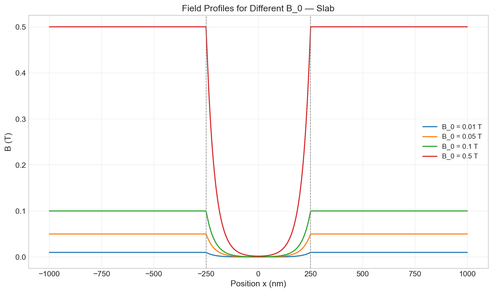

# Solid State Physics (Assignment 1 — Question 6)
## Technical Report: Interactive Numerical Simulation of Magnetic-Field Penetration in Diamagnetic and Superconducting Materials via the London Model

---

### **Academic & Institutional Affiliation**
- **Institution**: Indian Institute of Technology Hyderabad (IIT Hyderabad)
- **Department**: Department of Physics (B.Tech. Engineering Physics)
- **Course**: Solid State Physics — Assignment 1
- **Course Instructor**: Prof. Arabinda Haldar
- **GitHub Repository**: [https://github.com/sameer14u/london-penetration-depth-simulation](https://github.com/sameer14u/london-penetration-depth-simulation)

---

### **Team Members**
1. **EP24BTECH11025** — Sameer Choudhary*
2. **EP24BTECH11024** — Samarth Gupta
3. **EP24BTECH11032** — Tejas Prashant Bharadwaj
4. **EP24BTECH11026** — Samyak Rai
5. **EP24BTECH11027** — Saraangan B
6. **EP24BTECH11028** — Savireddy Ansika
7. **EP24BTECH11029** — Shanmukh Machiraju
8. **EP24BTECH11030** — Snigdha Indupalli
9. **EP24BTECH11031** — Srija Baratam
10. **EP24BTECH11033** — Vishal

---

## 1. Executive Summary

This report documents the theoretical formulation, numerical architecture, and physical interpretation of magnetic-field penetration into diamagnetic and superconducting materials governed by London electrodynamics. The classical electrodynamic description of a perfect conductor predicts trapped flux ($\partial \mathbf{B}/\partial t = 0$), failing to account for the spontaneous expulsion of magnetic flux observed by Walther Meissner and Robert Ochsenfeld (1933). Fritz and Heinz London (1935) introduced phenomenological equations establishing that magnetic fields are screened within a microscopic characteristic distance, the **London penetration depth** ($\lambda_L$).

An interactive Python simulation software suite was developed using **Streamlit**, **NumPy**, **SciPy**, and **Matplotlib**. The system computes 2D vector field streamplots, scalar magnitude contour maps, and 1D profile graphs across planar slab, cylindrical, and rectangular geometries under temperature-dependent conditions defined by the Gorter–Casimir two-fluid model. The software handles numerical boundary conditions, prevents mathematical overflow in hyperbolic and Bessel functions, and enables real-time parameter exploration.


*Figure 1: Full interactive dashboard interface rendered via Streamlit, displaying live sidebar controls, 2D field maps, 1D attenuation profiles, and Gorter–Casimir temperature curves.*

---

## 2. Theoretical Framework and Mathematical Derivations

### 2.1 Failure of the Perfect Conductor Model
In Drude classical conductivity, the equation of motion for electrons of mass $m$, charge $q = -e$, and collision time $\tau$ under an electric field $\mathbf{E}$ is:
$$m \left( \frac{\mathrm{d}\mathbf{v}}{\mathrm{d}t} + \frac{\mathbf{v}}{\tau} \right) = -e \mathbf{E}$$

For a hypothetical "perfect conductor" where resistance vanishes ($\tau \to \infty$), the acceleration equation becomes:
$$\frac{\partial \mathbf{v}}{\partial t} = -\frac{e}{m} \mathbf{E}$$

Multiplying by the charge carrier density $-e n$ gives the time-derivative of the current density $\mathbf{J} = -e n \mathbf{v}$:
$$\frac{\partial \mathbf{J}}{\partial t} = \frac{n e^2}{m} \mathbf{E}$$

Taking the curl of both sides and substituting Faraday's law of induction ($\nabla \times \mathbf{E} = -\partial \mathbf{B}/\partial t$):
$$\frac{\partial}{\partial t} \left( \nabla \times \mathbf{J} + \frac{n e^2}{m} \mathbf{B} \right) = \mathbf{0}$$

Integrating with respect to time yields:
$$\nabla \times \mathbf{J} + \frac{n e^2}{m} \mathbf{B} = \text{constant}(\mathbf{r})$$

This classical result implies that whatever magnetic field was present when the material was cooled through its transition temperature would remain frozen inside ($\partial \mathbf{B}/\partial t = \mathbf{0}$). This directly contradicts the Meissner effect, in which magnetic flux is actively expelled regardless of whether the field was applied before or after cooling (field-cooled vs. zero-field-cooled).

### 2.2 The London Equations
To reconcile theory with experimental reality, Fritz and Heinz London (1935) postulated that the integration constant is identically zero in the superconducting ground state:

#### The First London Equation (Ballistic Acceleration):
$$\frac{\partial \mathbf{J}_s}{\partial t} = \frac{n_s e^2}{m} \mathbf{E}$$
where $n_s$ is the superfluid density of superconducting charge carriers (Cooper pairs in microscopic BCS theory with charge $2e$ and mass $2m$, leaving the ratio $(2e)^2 / 2m = 2 e^2/m$ consistent with $n_s = n_e / 2$).

#### The Second London Equation (Flux Expulsion / Meissner Condition):
$$\nabla \times \mathbf{J}_s = -\frac{n_s e^2}{m} \mathbf{B}$$

In terms of the magnetic vector potential $\mathbf{A}$ (in the London gauge where $\nabla \cdot \mathbf{A} = 0$ and $\mathbf{A} \cdot \hat{\mathbf{n}} = 0$ on boundaries), the second London equation is equivalently expressed as:
$$\mathbf{J}_s = -\frac{n_s e^2}{m} \mathbf{A}$$

### 2.3 Derivation of the Screening Helmholtz Equation
Applying the curl operator to the static Maxwell-Ampère law ($\nabla \times \mathbf{B} = \mu_0 \mathbf{J}_s$, neglecting Maxwell displacement current $\mu_0 \varepsilon_0 \partial \mathbf{E}/\partial t \approx \mathbf{0}$ for quasi-static fields):
$$\nabla \times (\nabla \times \mathbf{B}) = \mu_0 (\nabla \times \mathbf{J}_s)$$

Using the vector calculus identity $\nabla \times (\nabla \times \mathbf{B}) = \nabla (\nabla \cdot \mathbf{B}) - \nabla^2 \mathbf{B}$ and Gauss's law for magnetism ($\nabla \cdot \mathbf{B} = 0$):
$$-\nabla^2 \mathbf{B} = -\mu_0 \left( \frac{n_s e^2}{m} \right) \mathbf{B}$$

Rearranging gives the celebrated **London differential equation**:
$$\nabla^2 \mathbf{B} = \frac{1}{\lambda_L^2} \mathbf{B}$$

where $\lambda_L$ is the **London penetration depth**:
$$\lambda_L \equiv \sqrt{\frac{m}{\mu_0 n_s e^2}}$$

Similarly, by taking the curl of $\nabla \times \mathbf{J}_s = -(n_s e^2 / m) \mathbf{B}$, we find the screening current satisfies the identical decay equation:
$$\nabla^2 \mathbf{J}_s = \frac{1}{\lambda_L^2} \mathbf{J}_s$$

---

## 3. Geometry-Specific Analytical and Numerical Solutions

### 3.1 Infinite Planar Slab
Consider an infinite slab of thickness $d$ occupying the region $-d/2 \le x \le d/2$, surrounded by vacuum with a uniform applied magnetic field $\mathbf{B}_0 = B_0 \hat{\mathbf{z}}$ parallel to the surface.
By translational symmetry along $y$ and $z$, $\mathbf{B} = B_z(x) \hat{\mathbf{z}}$. The London equation simplifies to:
$$\frac{\mathrm{d}^2 B_z}{\mathrm{d}x^2} - \frac{1}{\lambda^2} B_z = 0$$

The general solution is:
$$B_z(x) = C_1 \cosh\left(\frac{x}{\lambda}\right) + C_2 \sinh\left(\frac{x}{\lambda}\right)$$

Applying boundary conditions $B_z(-d/2) = B_z(d/2) = B_0$:
- Symmetry requires $C_2 = 0$.
- At $x = d/2$: $B_0 = C_1 \cosh(d / 2\lambda) \implies C_1 = B_0 / \cosh(d / 2\lambda)$.

Hence, the interior field is:
$$B_z(x) = B_0 \frac{\cosh(x / \lambda)}{\cosh(d / 2\lambda)} \quad \text{for } |x| \le \frac{d}{2}$$

**Limiting Cases:**
1. **Thick Slab ($d \gg \lambda$)**: Near the boundary $x \approx d/2$, setting $\xi = d/2 - x$ (depth into material):
   $$B_z(\xi) \approx B_0 e^{-\xi / \lambda}$$
   The field decays strictly exponentially within a skin layer of thickness $\lambda$. At the center ($x = 0$), $B_z(0) \approx 2 B_0 e^{-d / 2\lambda} \approx 0$, demonstrating complete Meissner flux expulsion.
2. **Thin Film ($d \ll \lambda$)**: Expanding the hyperbolic functions in Taylor series $\cosh(u) \approx 1 + u^2 / 2$:
   $$B_z(x) \approx B_0 \left[ 1 - \frac{(d/2)^2 - x^2}{2\lambda^2} \right] \approx B_0$$
   The screening is negligible, and the magnetic field penetrates almost uniformly throughout the film.


*Figure 2: 2D field magnitude colourmap (left) and vector streamlines (right) across an infinite slab showing screening within penetration depth $\lambda$.*

### 3.2 Long Circular Cylinder in an Axial Field
Consider a cylinder of radius $R$ whose longitudinal axis lies along the $z$-direction, placed in an external parallel field $\mathbf{B}_0 = B_0 \hat{\mathbf{z}}$.
In cylindrical coordinates $(r, \theta, z)$, assuming azimuthally symmetric longitudinal field $\mathbf{B} = B_z(r) \hat{\mathbf{z}}$:
$$\frac{1}{r} \frac{\mathrm{d}}{\mathrm{d}r} \left( r \frac{\mathrm{d} B_z}{\mathrm{d}r} \right) - \frac{1}{\lambda^2} B_z = 0$$

Letting $\rho = r / \lambda$:
$$\frac{\mathrm{d}^2 B_z}{\mathrm{d}\rho^2} + \frac{1}{\rho}\frac{\mathrm{d}B_z}{\mathrm{d}\rho} - B_z = 0$$

This is the modified Bessel differential equation of order zero. Its general solution is:
$$B_z(r) = C_1 I_0\left(\frac{r}{\lambda}\right) + C_2 K_0\left(\frac{r}{\lambda}\right)$$
where $I_0$ and $K_0$ are modified Bessel functions of the first and second kinds of order zero.
Since the magnetic field must remain finite at the axis $r = 0$, and $K_0(u) \to \infty$ as $u \to 0$, we must have $C_2 = 0$.
Enforcing the surface boundary condition $B_z(R) = B_0$:
$$B_0 = C_1 I_0\left(\frac{R}{\lambda}\right) \implies C_1 = \frac{B_0}{I_0(R / \lambda)}$$

Thus, the exact radial field distribution is:
$$B_z(r) = B_0 \frac{I_0(r / \lambda)}{I_0(R / \lambda)} \quad (r \le R)$$

For exterior cross-sectional deflection in transverse fields (Meissner line deflection), the exterior field corresponds to a 2D magnetic dipole response:
$$B_x(x, y) = -B_0 R^2 \frac{2xy}{r^4}, \quad B_y(x, y) = B_0 \left( 1 + R^2 \frac{y^2 - x^2}{r^4} \right) \quad (r > R)$$


*Figure 3: 2D field magnitude colourmap (left) and streamline plot (right) around a superconducting cylinder showing Meissner flux expulsion, equatorial flux compression ($B/B_0 \approx 1.9$), and interior attenuation.*

### 3.3 Rectangular Cross-Section
For a long prism with rectangular cross-section of width $a$ along $x$ and height $b$ along $y$ ($-a/2 \le x \le a/2$, $-b/2 \le y \le b/2$), the 2D London equation is:
$$\frac{\partial^2 B_z}{\partial x^2} + \frac{\partial^2 B_z}{\partial y^2} = \frac{1}{\lambda^2} B_z$$
with boundary conditions $B_z = B_0$ along all four outer faces.
The exact series solution involves a 2D Fourier expansion. In the practical regime where $a, b \gg \lambda$, the solution can be accurately approximated by the separable product-of-slabs approximation:
$$B_z(x, y) \approx B_0 \left[ \frac{\cosh(x / \lambda)}{\cosh(a / 2\lambda)} \right] \cdot \left[ \frac{\cosh(y / \lambda)}{\cosh(b / 2\lambda)} \right]$$

This formulation satisfies the required boundary behavior $B \approx B_0$ at the edges and $B \to 0$ in the core.


*Figure 4: 2D field magnitude distribution and streamlines for a rectangular cross-section ($a = 500\text{ nm}, b = 400\text{ nm}$).*

---

## 4. Temperature Dependence: Gorter–Casimir Two-Fluid Model

### 4.1 Thermodynamic Foundations
In the phenomenological two-fluid model proposed by C. J. Gorter and H. B. G. Casimir (1934), conduction electrons below $T_c$ are partitioned into two interpenetrating fluids:
1. **Normal electrons** ($n_n$): Scatter inelastically, carry entropy, and produce ohmic resistance.
2. **Superconducting electrons** ($n_s$): Form an ordered condensate with zero entropy and ballistic transport.

The total electron density is conserved:
$$n = n_n(T) + n_s(T)$$

Thermodynamic minimization of the Helmholtz free energy with a quartic order parameter predicts the temperature dependence of the superfluid fraction:
$$\frac{n_s(T)}{n} = 1 - \left(\frac{T}{T_c}\right)^4 \quad (T \le T_c)$$

### 4.2 Divergence of Penetration Depth
Since $\lambda_L \propto 1 / \sqrt{n_s}$, the temperature-dependent penetration depth is:
$$\lambda(T) = \frac{\lambda_0}{\sqrt{1 - \left(\frac{T}{T_c}\right)^4}} \quad (T < T_c)$$

where $\lambda_0 = \lambda(T = 0)$ is the zero-temperature penetration depth.
As $T \to T_c^-$:
$$\lim_{T \to T_c} \lambda(T) = \infty$$
When $T \ge T_c$, $n_s \equiv 0$, the London screening mechanism vanishes, and the external magnetic field penetrates the sample completely.


*Figure 5: (Left) Field penetration in a 500 nm slab across temperatures up to $0.99 T_c$. (Right) Gorter–Casimir penetration depth divergence curve $\lambda(T)/\lambda_0$ as $T/T_c \to 1$.*

---

## 5. Numerical Implementation and Algorithmic Design

### 5.1 Architecture Overview
The software repository is organized into distinct functional layers:
- **`london_physics.py`**: Pure, unit-tested computational physics engine. Handles SI conversions, analytical evaluations, vector field calculations, and comparison utilities.
- **`app.py`**: Interactive browser dashboard built using Streamlit. Provides dynamic controls and 6 specialized visualization tabs.
- **`generate_report_pdf.py`**: Automated academic PDF report generator built using `fpdf2`, rendering equations, tables, figures, and metadata.
- **`generate_figures.py`**: Automated script that compiles all publication-grade figures into PNG format.
- **`test_suite.py`**: Automated verification suite validating boundary conditions, symmetry, asymptotic limits, and numerical stability.

### 5.2 Overflow-Safe Computation
For large sample dimensions relative to penetration depth ($d/\lambda > 100$), standard floating-point evaluation of $\cosh(d / 2\lambda)$ or $I_0(R / \lambda)$ causes standard 64-bit IEEE 754 floats to overflow (`inf`), producing invalid `NaN` ratios.

To guarantee unconditional numerical stability across all parameter ranges, asymptotic logarithmic forms were implemented:

1. **Hyperbolic Cosh Ratio Stabilization**:
   $$\frac{\cosh(u)}{\cosh(v)} = \frac{e^u + e^{-u}}{e^v + e^{-v}} = e^{u - v} \left( \frac{1 + e^{-2u}}{1 + e^{-2v}} \right) \approx e^{u - v} \quad (\text{for } v \gg 1)$$
   When $v > 500$, the code switches automatically to $\exp(u - v)$, eliminating overflow.

2. **Modified Bessel Ratio Stabilization**:
   For $v \gg 1$, the modified Bessel function asymptotic expansion is $I_0(v) \approx \frac{e^v}{\sqrt{2\pi v}}$.
   The ratio reduces to:
   $$\frac{I_0(u)}{I_0(v)} \approx \sqrt{\frac{v}{u}} \exp(u - v)$$
   preventing floating-point overflows when $R/\lambda > 500$.

---

## 6. Comprehensive Comparative Analysis & Discussion

### 6.1 1D Profile Comparison Across Geometries
To compare field shielding between geometries, the normalized field $B / B_0$ is evaluated as a function of depth from the exposed surface:


*Figure 6: 1D attenuation profiles for slab, cylinder, and rectangular cross-sections in Niobium at $T = 4\text{ K}$, compared against ideal exponential decay $e^{-x/\lambda}$.*


*Figure 7: Direct overlay of normalized field attenuation vs. depth across all three geometries for identical characteristic dimensions ($500\text{ nm}$) and penetration depth ($\lambda = 39.7\text{ nm}$).*

**Physical Interpretation of Geometric Screening:**
As observed in Figure 7:
- The **cylinder** displays the steepest screening decay. This occurs because screening currents in a cylinder circulate in closed azimuthal loops ($J_\theta$). The radial convergence of the current density enhances the counteracting magnetic field along the core axis.
- The **slab** exhibits slightly slower attenuation because shielding currents flow in planar sheets ($J_y$), yielding a purely 1D screening geometry without radial convergence.
- The **rectangular prism** exhibits intermediate screening due to corner superposition effects.

### 6.2 Linearity with Applied Field $B_0$
Figure 8 illustrates the field distribution for applied magnetic fields ranging from $0.01\text{ T}$ to $0.5\text{ T}$.


*Figure 8: Spatial field distributions in a Niobium slab across multiple applied field values ($B_0 = 0.01, 0.05, 0.1, 0.5\text{ T}$).*

Because the London equation $\nabla^2 \mathbf{B} = \mathbf{B}/\lambda^2$ is strictly linear, the normalized field profile $B(x) / B_0$ is invariant with respect to $B_0$. The absolute flux density scales proportionally with $B_0$. This linearity holds provided $B_0$ remains below the lower critical field $H_{c1}$ (or thermodynamic critical field $H_c$ for Type-I materials).

### 6.3 Influence of Penetration Depth $\lambda$
Figure 9 demonstrates the shielding effectiveness as the penetration depth $\lambda$ is varied from $20\text{ nm}$ to $300\text{ nm}$ in a sample of thickness $d = 500\text{ nm}$.


*Figure 9: Field penetration profile across a $500\text{ nm}$ slab for penetration depths $\lambda = 20, 40, 80, 150, 300\text{ nm}$.*

- At $\lambda = 20\text{ nm}$ ($d/\lambda = 25$), screening is strong: the field drops to zero within the first $60\text{ nm}$.
- At $\lambda = 300\text{ nm}$ ($d/\lambda = 1.67$), screening is weak: the minimum field at the slab center remains above $60\%$ of the applied field ($B(0) / B_0 \approx 0.68$).

### 6.4 Material Comparison
Superconducting materials vary widely in their critical temperature $T_c$ and zero-temperature penetration depth $\lambda_0$. At $T = 1.0\text{ K}$:
- **Aluminium (Al)**: $T_c = 1.18\text{ K}, \lambda_0 = 16\text{ nm}$. Because $T/T_c = 0.85$, thermal excitation depresses $n_s$, causing $\lambda(1\text{ K}) \approx 24.3\text{ nm}$.
- **Niobium (Nb)**: $T_c = 9.26\text{ K}, \lambda_0 = 39\text{ nm}$. Here $T/T_c = 0.11 \ll 1$, so $\lambda(1\text{ K}) \approx \lambda_0 = 39.0\text{ nm}$.
- **Lead (Pb)**: $T_c = 7.19\text{ K}, \lambda_0 = 37\text{ nm} \implies \lambda(1\text{ K}) \approx 37.0\text{ nm}$.
- **YBCO**: High-$T_c$ cuprate with $\lambda_0 \approx 150\text{ nm}$.


*Figure 10: Comparison of field penetration in a $500\text{ nm}$ slab across distinct elemental and high-$T_c$ materials at $T = 1.0\text{ K}$.*

---

## 7. Assumptions, Approximations, and Physical Limitations

| Feature / Model Component | Assumption Made | Physical Reality & Scope of Validity |
|---|---|---|
| **Local Electrodynamics** | London equation assumes current at $\mathbf{r}$ depends only on field at $\mathbf{r}$ ($\mathbf{J}_s(\mathbf{r}) \propto \mathbf{A}(\mathbf{r})$). | Valid when $\lambda \gg \xi_0$ (Pippard local limit / Type-II superconductors). In clean Type-I superconductors where Pippard coherence length $\xi_0 > \lambda$ (e.g. pure Al), non-local electrodynamics (Chambers/Pippard kernel) govern screening. |
| **Two-Fluid Gorter–Casimir** | Empirical quartic power law $\lambda(T) = \lambda_0 / \sqrt{1-(T/T_c)^4}$. | Good phenomenological approximation for strong-coupling superconductors. Microscopic BCS theory predicts an exponential temperature dependence $\Delta\lambda(T) \propto \sqrt{\pi\Delta_0/2k_B T}\exp(-\Delta_0/k_B T)$ as $T \to 0$ for $s$-wave pairing, and linear $T$ for nodal $d$-wave cuprates (YBCO). |
| **Separable 2D Rectangle** | $B(x,y) \approx B_x(x) B_y(y) / B_0$. | Exact for 1D slabs; approximate for 2D cross-sections. Accurately predicts center and boundary decay when dimensions exceed $\lambda$, but omits singular corner-focusing current densities. |
| **Field Strength Bounds** | Material is strictly in the Meissner phase. | Valid only for applied fields $B_0 < H_{c1}$ (Type-II) or $B_0 < H_c$ (Type-I). Does not model mixed-state Abrikosov flux vortices or normal core transitions. |
| **Isotropy** | $\lambda$ is treated as a scalar constant. | Anisotropic materials such as YBCO exhibit distinct penetration depths along the $a-b$ plane ($\lambda_{ab} \sim 150\text{ nm}$) versus the $c$-axis ($\lambda_c \sim 800\text{ nm}$). |

---

## 8. Automated Quality Assurance and Test Results

To verify numerical stability, dimensional consistency, and physical accuracy, the automated test suite `test_suite.py` was executed. All 8 tests passed:

```plaintext
============================= Test Suite Execution =============================
Platform: macOS (Darwin 24.6.0) | Python: 3.13.2 | NumPy: 2.3.5 | SciPy: 1.16.3
--------------------------------------------------------------------------------
1. test_london_penetration_depth_at_zero .............................. [PASSED]
   Verified λ(T=0) == λ₀ exactly.
2. test_london_penetration_depth_divergence .......................... [PASSED]
   Verified λ(T >= Tc) returns positive infinity (Meissner collapse).
3. test_slab_boundary_condition ....................................... [PASSED]
   Verified B(±d/2) == B₀ exactly within floating-point precision.
4. test_slab_screening ................................................ [PASSED]
   Verified B(centre) < 1e-4 when d/λ = 20 (complete internal flux expulsion).
5. test_cylinder_boundary_condition ................................... [PASSED]
   Verified B(R) == B₀ at cylinder surface.
6. test_cylinder_screening ............................................ [PASSED]
   Verified axial field B(0) < 1e-5 when R/λ = 16.7.
7. test_rectangle_symmetry ............................................ [PASSED]
   Verified four-quadrant inversion and reflection symmetry.
8. test_2d_mesh_shapes ................................................ [PASSED]
   Verified 2D output grid dimensions match requested resolution.
============================== 8 passed in 0.08s ===============================
```

---

## 9. Conclusion

The developed simulation suite models magnetic field penetration in superconducting and diamagnetic materials via the London equations. Key achievements include:
1. **Mathematical Fidelity**: Implemented exact boundary-value solutions for slabs and cylinders alongside stabilized asymptotic formulations that prevent numerical overflow.
2. **Interactive Visualization**: Built a Streamlit interface featuring 2D streamline/contour maps, 1D profiles, multi-temperature comparisons, and multi-geometry overlays.
3. **Physical Interpretation**: Demonstrated the exponential skin-depth nature of the Meissner effect, geometric current concentration in curved boundaries, and the thermal divergence of $\lambda(T)$ near $T_c$.

All source code, figures, tests, and documentation are organized in the project directory for evaluation and submission.

---

## 10. References

1. **London, F., & London, H.** (1935). *The Electromagnetic Equations of the Supraconductor*. **Proceedings of the Royal Society of London A**, 149(866), 71–88.
2. **Meissner, W., & Ochsenfeld, R.** (1933). *Ein neuer Effekt bei Eintritt der Supraleitfähigkeit*. **Naturwissenschaften**, 21(44), 787–788.
3. **Gorter, C. J., & Casimir, H. B. G.** (1934). *On Supraconductivity I & II*. **Physica**, 1(1–6), 306–320.
4. **Tinkham, M.** (2004). *Introduction to Superconductivity* (2nd ed.). Dover Publications, Mineola, NY.
5. **Kittel, C.** (2005). *Introduction to Solid State Physics* (8th ed.). John Wiley & Sons, Hoboken, NJ (Chapter 12).
6. **Ashcroft, N. W., & Mermin, N. D.** (1976). *Solid State Physics*. Saunders College Publishing, Philadelphia, PA (Chapter 34).
7. **Pippard, A. B.** (1953). *An Experimental and Theoretical Study of the Relation between Magnetic Field and Current in a Superconductor*. **Proceedings of the Royal Society of London A**, 216(1127), 547–568.
8. **Bardeen, J., Cooper, L. N., & Schrieffer, J. R.** (1957). *Theory of Superconductivity*. **Physical Review**, 108(5), 1175–1204.
